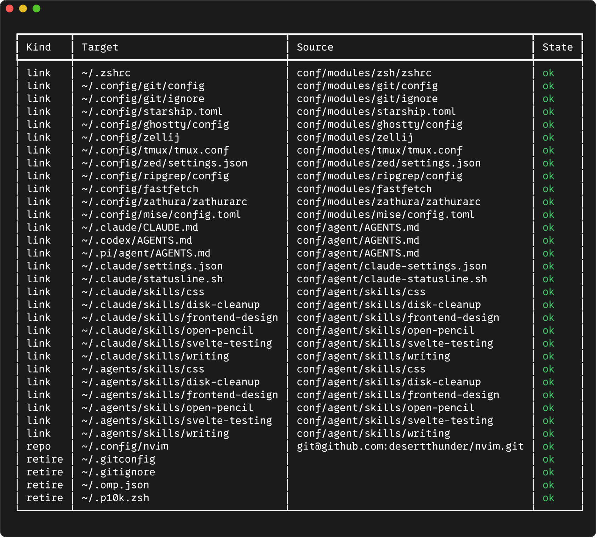
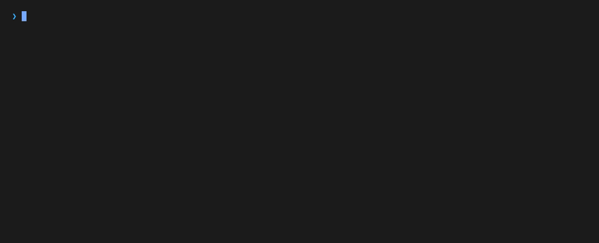
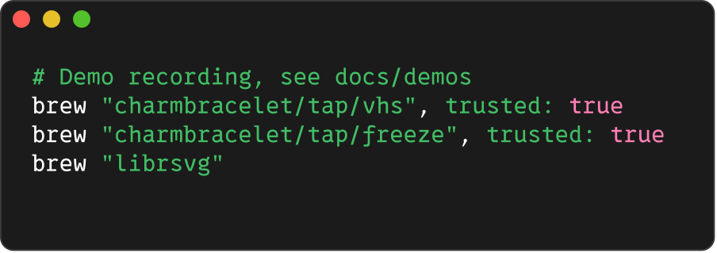
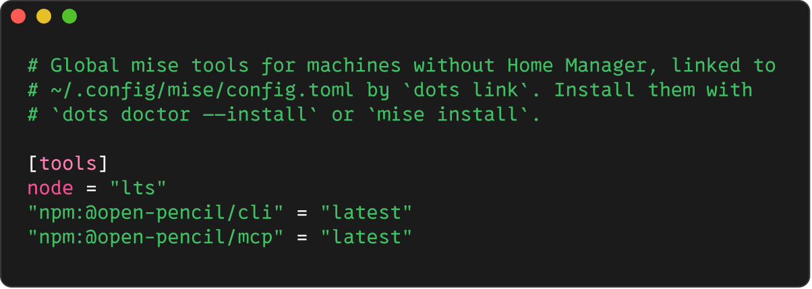
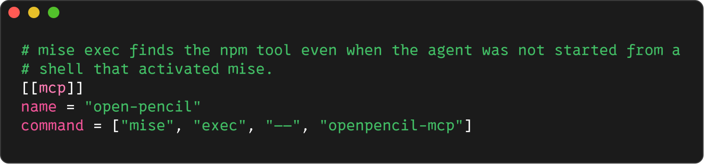

# Dotfiles

On machines without Nix, the `dots` command links this repository's config into
the home directory, installs packages with Homebrew and mise, and registers MCP
servers with Claude Code. NixOS hosts get the same files from Home Manager, and
`dots` refuses to change them.

Install `dots` once from the repository root:

```bash
conf/scripts/install.sh
```

## Link config

`conf/dots.toml` lists every managed path. `dots link` shows what would change,
and `dots link --apply` makes the changes. Files that are replaced are moved into
`~/.local/state/dots/runs/<run>/`, and `dots restore` puts them back.


`dots status` lists each path and whether it matches. A linked home looks like
this:



| Command                   | What it does                                                                |
| ------------------------- | --------------------------------------------------------------------------- |
| `dots status [--diff]`    | Shows each managed path, and with `--diff`, how changed files differ.       |
| `dots link [--apply]`     | Links, clones, and retires paths to match the manifest.                     |
| `dots restore [run]`      | Undoes the latest run, or the named one.                                    |
| `dots adopt <path>`       | Copies a local config into the repository and links it back.                |
| `dots doctor [--install]` | Checks packages, mise tools, and MCP servers, and installs what is missing. |
| `dots mcp [--apply]`      | Registers the manifest's MCP servers with Claude Code.                      |

Some config is still set up by hand:

| Config   | Source                                     |
| -------- | ------------------------------------------ |
| SSH keys | `conf/scripts/keys.sh` plus SOPS age key   |
| Secrets  | `~/.config/zsh/local.zsh`, never committed |

## Install packages

`dots doctor` checks the packages in `conf/packages/Brewfile`, the tools in
`conf/modules/mise/config.toml`, oh-my-zsh, and the MCP servers in
`conf/dots.toml`. `dots doctor --install` installs anything missing. It never
upgrades or removes packages.



### Third-party taps

Homebrew refuses formulae and casks from taps you have not trusted. Each
Brewfile entry from a third-party tap carries `trusted: true`, which records in
Git that the tap was reviewed:



When `dots doctor --install` finds a third-party entry without `trusted: true`,
it asks before trusting it and then adds `trusted: true` to that line. Commit
the change with the new entry. Without `--install`, `dots doctor` stops at the
first untrusted entry.

### Node and npm tools

mise installs Node and global npm tools. `dots link` links its config to
`~/.config/mise/config.toml`, and the zshrc activates mise when it is
installed.



Add a tool with an `npm:` entry, then run `dots doctor --install` or
`mise install`.

## OpenPencil

[OpenPencil](https://openpencil.dev/) is a design editor that opens Figma
files. Three pieces set it up:

| Piece              | Source                                                                 |
| ------------------ | ---------------------------------------------------------------------- |
| App                | `cask "openpencil"` in the Brewfile                                    |
| CLI and MCP server | `@open-pencil/cli` and `@open-pencil/mcp` in the mise config           |
| Agent skill        | `conf/agent/skills/open-pencil`, see [Agent skills](./agent-skills.md) |

Claude Code keeps MCP servers in `~/.claude.json`, which holds application
state and cannot be linked. Instead, `conf/dots.toml` lists the server and
`dots mcp --apply` registers it at user scope:



The command runs through `mise exec` so the server starts even when Claude Code
was not launched from a shell that activated mise. To register it by hand:

```bash
claude mcp add --scope user open-pencil -- mise exec -- openpencil-mcp
```

The linked Claude Code settings allow the server's tools without a prompt.

## Record the demos

Re-record this page's GIFs and stills with `docs/demos/record.sh`.
